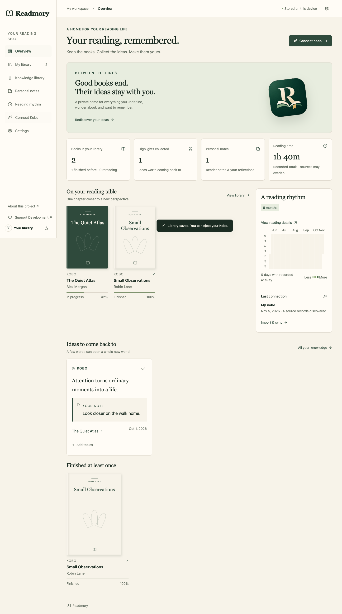

# Kobo Books Summary

A local-first reading knowledge platform for **Kobo, KOReader, and Kobalt**. Keep your books, highlights, personal notes, and reflections in one private browser workspace—without an account or a server database.



## Features

- Import native Kobo databases, KOReader statistics/sidecars, and Kobalt SQLite annotations and reading state.
- Keep **store previews and catalog records separate** from the reading shelf and statistics by default. Downloaded unread books and recorded reading history remain visible. An optional library toggle reveals store records without deleting anything.
- Browse your library, search multilingual annotations, save favorites, organize topics, connect ideas across books, and write personal reflections.
- Preserve source ids, quotation/note separation, source-hidden annotations, historical records, and repeated-import identity.
- Use local Kobo/EPUB covers first. Optional automatic enrichment looks up the reading library in grouped requests, saves confident covers/metadata, and resumes pending work. **Find cover** remains available for manual review. Both disclose the metadata shared; cached results work offline.
- Track **ever finished** and recorded completion dates separately from current progress. Label rereading as observed/inferred, preserve known history across imports, and distinguish start counters from reread counts.
- Export book notes to Markdown/JSON, and back up or restore the complete local library.
- Responsive light/dark interface, recorded activity calendar, and offline browsing after the production app has loaded.

## Public beta

The source is ready to run locally. Website publication is pending the hosting credential handoff; a live URL will be added after deployment is verified.

Public beta: imports and library storage stay in your browser. Optional Open Library lookup is off until enabled. Back up regularly; site data can be cleared. See [PRIVACY.md](PRIVACY.md).

## Open the app

On macOS, double-click **Open Kobo Books Summary.command** in the project folder. It starts the local server and opens [http://127.0.0.1:3000](http://127.0.0.1:3000). Keep its Terminal window open. If already installed/built, `pnpm start` is the equivalent terminal command.

Your data belongs to the browser/profile that imported it. The Codex preview and regular Chrome have separate local libraries even at the same URL. To move to your everyday browser, download a backup in the current preview and restore it once in the other browser. The launcher does not silently move private data between profiles.

## Quick start

Use Node.js 24 and pnpm 11.

```sh
pnpm install
pnpm fixtures  # synthetic test files only
pnpm dev
```

Open [http://127.0.0.1:3000](http://127.0.0.1:3000). Use the same browser and origin: `localhost` and `127.0.0.1` have separate libraries. SQLite WASM is bundled during installation; no CDN is required. Framework telemetry is disabled by the project scripts.

For offline use, build and start production, then load the app once:

```sh
pnpm build
pnpm start
```

The production build generates an offline asset manifest and precaches every application/worker chunk, including dependencies first loaded inside the worker. Development mode does not install a new offline service worker. Use separate ports if switching between a production preview and development. Restart the production server after rebuilding. Startup scripts are tested on macOS/Linux; Windows users can use WSL.

## Connect your reader

1. Connect the Kobo by USB and enable storage mode on its screen.
2. Open **Connect Kobo** and choose a stable device identity. Reuse it on later imports.
3. Select the mounted folder, or choose supported database/metadata files. On macOS, **Cmd + Shift + .** reveals hidden folders in file pickers.
4. Review reading-library counts, separately retained store records, source diagnostics, and possible editions. Confirm the import.
5. Disconnect and browse locally. Files on the Kobo are never modified.

Supported sources:

| Reader   | Source                                       | Imported data                                                                                            |
| -------- | -------------------------------------------- | -------------------------------------------------------------------------------------------------------- |
| Kobo     | `.kobo/KoboReader.sqlite`                    | Book metadata, progress/status, collections, highlights/notes, available aggregate time and dates        |
| KOReader | `.adds/koreader/settings/statistics.sqlite3` | Book totals and recorded page-reading intervals                                                          |
| KOReader | `*.sdr/metadata.*.lua`                       | Progress, book properties, modern highlights/notes and supported legacy highlights                       |
| Kobalt   | `.adds/kobalt/kobalt.sqlite`                 | Highlights, personal notes, bookmarks, book state/progress and recorded reading sessions where available |

Kobalt bookmarks remain labeled bookmarks and do not inflate highlight counts. Kobalt session timestamps and active durations use milliseconds in the source and are normalized to ISO dates/seconds. Native, KOReader and Kobalt records retain separate provenance; verified same-file/ISBN records share one shelf card. Uncertain matches can be combined manually in book details and split again. All source records and annotations remain intact.

### Safe snapshots

Keep the Kobo in USB storage mode. A selected nonempty WAL or rollback journal blocks raw import of that database: the browser cannot replay it. An individual-file picker cannot detect a companion you did not select.

For repeatable standalone snapshots:

```sh
python3 scripts/snapshot-device.py \
  --device /Volumes/KOBOeReader \
  --output /private/tmp/my-kobo-snapshot --include-covers
```

Select the output folder in the app. The helper copies databases/companions into temporary storage, checks source stability, and uses SQLite backup on the copies. It includes KOReader sidecars. Optional `--include-covers` copies one available local image per native reading-book identifier; no EPUB content is copied. Use a fresh output directory for each run, outside Git. The mounted originals are never opened by SQLite or modified.

### Cover lookup and privacy

Local cover assets are preferred, with generated artwork as a fallback. In book details, **Find cover → Search Open Library** sends the selected book's ISBN, or title/author if no usable ISBN exists, directly from the browser to Open Library. Choose a candidate to download its cover. Notes, highlights and reflections are never sent. By default no remote lookup runs on import or page load. **Settings → Automatic covers & metadata** enables automatic processing for reading-library records, including new imports. It sends titles/authors or ISBNs once per grouped lookup title, spaces requests by at least four seconds, caches completed jobs with query identity and matcher version, and backs off for fifteen minutes on provider failures. Preview/catalog records are excluded. Ambiguous matches require review. Missing results expire after 30 days or can be retried manually; failed covers are included in retry controls. Publication year/languages/subjects are attributed as work-level metadata and never overwrite source fields.

Open Library is a public, open-source service with a [Covers API](https://openlibrary.org/dev/docs/api/covers). Coverage varies; the API can return no cover or impose rate limits. Review edition matches. Artwork retains its original rights; the project does not distribute third-party book covers in its repository. Attribution is saved with downloaded covers. API response/download limits and allowed hosts are enforced.

## Keep your data safe

- Your library lives inside this browser's origin/profile, using SQLite WASM in a worker with OPFS persistence and an IndexedDB fallback.
- Browser/site-data deletion can erase the library. Use **Settings → Download backup** regularly. Backups contain private data; protect them.
- Restore validates the file and replaces data only after confirmation. Invalid backups leave existing data intact.
- Missing source records are retained. Previously known metadata survives imports containing only orphan annotations.
- Source-unavailable statistics stay unavailable. Kobo aggregate time is not turned into invented sessions. Independent reader totals can overlap and are labeled accordingly.
- Reimport older Kobo snapshots once after upgrading to populate store/preview classification. Existing personal knowledge is preserved; store records can be revealed with the library toggle.

## Verify

```sh
pnpm fixtures
pnpm typecheck
pnpm lint
pnpm test
pnpm build
pnpm test:e2e
```

Playwright starts a local production server when needed. By default it uses installed Chrome in isolated test profiles. For bundled Chromium:

```sh
pnpm exec playwright install chromium
PLAYWRIGHT_CHANNEL=chromium pnpm test:e2e
```

Optional private hardware validation (fixtures are never included):

```sh
KOBO_PRIVATE_FIXTURES=/private/tmp/my-kobo-snapshot pnpm test
KOBO_PRIVATE_FIXTURES=/private/tmp/my-kobo-snapshot pnpm test:e2e
```

GitHub Actions runs synthetic tests, type checking, lint, production build, and Chromium E2E. See [implementation status](docs/IMPLEMENTATION.md) for verification limits and [architecture](docs/ARCHITECTURE.md) for design details.

## Contribute and support

See [CONTRIBUTING.md](CONTRIBUTING.md), [SECURITY.md](SECURITY.md), and [SUPPORT.md](SUPPORT.md). [Support development on Ko-fi](https://ko-fi.com/hutomoivan), entirely optionally. Hosting configuration and GitHub-connected Cloudflare Pages instructions are in [docs/CLOUDFLARE_DEPLOYMENT.md](docs/CLOUDFLARE_DEPLOYMENT.md). AI providers, semantic search, desktop USB discovery, scheduled review and social cards remain future work.

## License and acknowledgments

[MIT](LICENSE), for this project's code. Dependencies and third-party artwork retain their own licenses. Thanks to the [Kobalt](https://github.com/nicoverbruggen/kobalt), [KOReader](https://github.com/koreader/koreader), [calibre](https://github.com/kovidgoyal/calibre), [sql.js](https://sql.js.org/) and [Open Library](https://openlibrary.org/) communities for their software and documented data formats.

This independent project is not affiliated with Rakuten Kobo, Kobalt, KOReader, or the Internet Archive. Kobo is a trademark of its respective owner. The repository screenshot and automated fixtures are synthetic; no personal reading databases, quotes, or EPUBs are included.

## Completion and rereading history

Book details show recorded source completion dates and finished states retained across imports. A current reading state after a known completion is labeled as inferred rereading unless a finished-to-reading state change was observed across imported snapshots. Kobalt completion pointers provide undated evidence, never an invented finish date. Kobo `TimesStartedReading` is displayed as a start counter, not a lifetime reread count. Exact historical reread counts are unavailable when the reader retained only its latest state/date.
